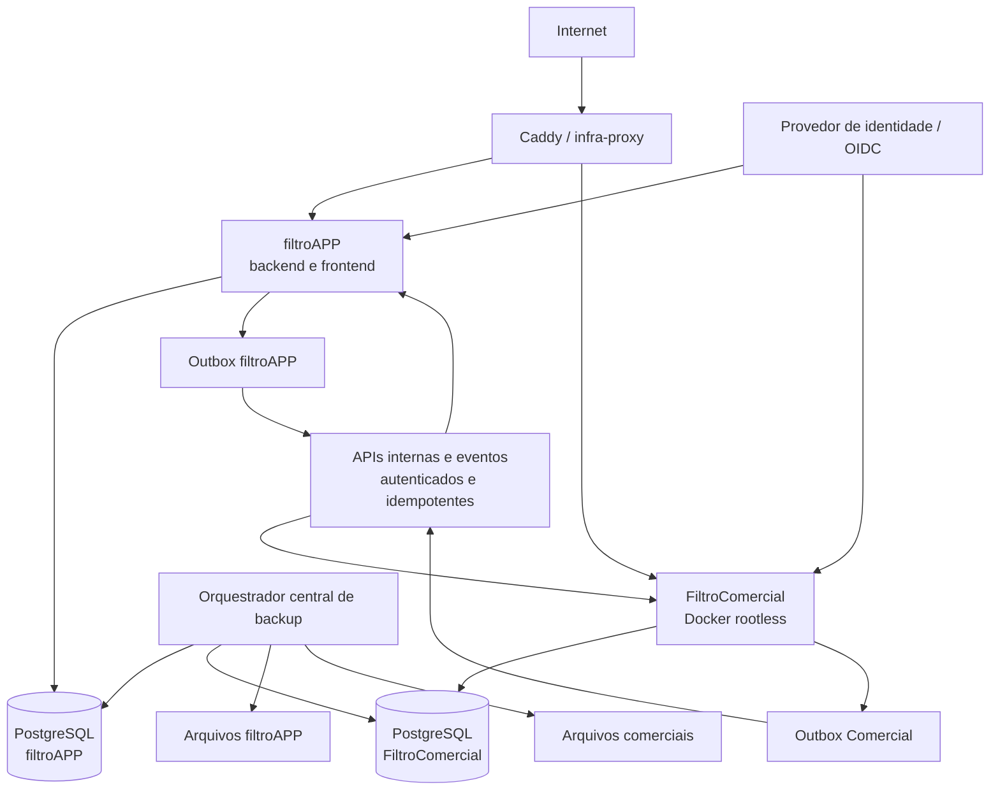

# Arquitetura para separação do FiltroComercial

> Planejamento para extrair o módulo Comercial do filtroAPP como aplicação
> independente, com banco de dados próprio e comunicação por APIs e eventos.

## Estado do documento

- Data da revisão: 1º de setembro de 2026
- Branch analisada: `origin/feat/modulo-comercial`
- Commit analisado: `5ac470ee6a97a1db7fe0a658094bddcabf6eab16`
- Nome recomendado: **FiltroComercial**
- Repositório recomendado: `filtro-comercial`
- Decisão vigente: **cada aplicativo terá seu próprio PostgreSQL**
- Status: planejamento arquitetural; não executa mudanças em produção

## Registro da decisão

Este documento substitui a recomendação anterior de compartilhar o mesmo banco
por meio dos schemas `public`, `comercial` e `integration`.

A decisão revisada é:

- o filtroAPP mantém seu banco PostgreSQL atual;
- o FiltroComercial recebe um PostgreSQL próprio;
- nenhum aplicativo acessa diretamente o banco do outro;
- consultas cruzadas usam APIs internas ou projeções locais;
- alterações importantes usam transactional outbox e entrega idempotente;
- autenticação não depende de leitura das tabelas de sessão do filtroAPP;
- cada repositório controla exclusivamente suas próprias migrations;
- o backup continua centralizado operacionalmente, mas gera artefatos separados.

### Motivo da revisão

O banco compartilhado seria mais simples no curto prazo, mas não oferece a melhor
fronteira para o cenário esperado:

- aplicativos sob usuários Linux diferentes;
- daemons Docker diferentes;
- possibilidade de desenvolvedores e responsáveis diferentes;
- necessidade de impedir alterações nos dados do filtroAPP;
- deploys e migrations independentes;
- possibilidade futura de mover um aplicativo para outra VPS;
- necessidade de reduzir o impacto de falhas, restores e mudanças de schema.

Com bancos separados, a credencial do FiltroComercial simplesmente não possui
validade no banco do filtroAPP. Essa é uma garantia estrutural mais forte que
depender apenas de grants dentro de um banco compartilhado.

## Resumo executivo

O FiltroComercial será uma aplicação independente, executada em Docker rootless
sob o usuário Linux `comercial`. Sua stack conterá:

- frontend e backend próprios;
- PostgreSQL próprio;
- rede Docker própria;
- volumes próprios para documentos e anexos;
- migrations próprias;
- sessões e papéis comerciais próprios;
- integrações Nectar, SharePoint e Google Maps próprias;
- API interna autenticada;
- outbox transacional para eventos;
- métricas, logs e backup próprios.

O filtroAPP continuará dono de:

- usuários e identidade existente durante a transição;
- projetos, contratos, missões e operação;
- relatórios operacionais;
- custos realizados;
- demais módulos e dados atuais.

Os dois aplicativos se comunicam por contratos explícitos. Nenhum deles recebe
endereço, credencial ou acesso de rede ao banco do outro.

## Arquitetura-alvo



### Fronteiras de segurança

```text
Usuário/daemon do filtroAPP
├── backend filtroAPP
├── PostgreSQL filtroAPP
├── volumes operacionais
└── migrations filtroAPP

Usuário/daemon comercial
├── backend FiltroComercial
├── PostgreSQL FiltroComercial
├── documentos e anexos comerciais
└── migrations FiltroComercial

Infraestrutura central
├── Caddy
├── DNS e TLS
├── backup e restore
├── monitoramento
└── canal interno entre APIs
```

## Princípios obrigatórios

1. Cada aplicativo é a única autoridade de escrita sobre seu banco.
2. Nenhum aplicativo recebe acesso direto ao banco do outro.
3. API é usada para consultas atuais e comandos síncronos.
4. Outbox e eventos são usados para alterações que não podem ser perdidas.
5. Webhook isolado, sem persistência e retentativa, não é considerado confiável.
6. Eventos e comandos precisam ser idempotentes.
7. Dados copiados para o outro aplicativo são projeções, não novas fontes oficiais.
8. Identidade é centralizada, mas autorização de negócio pertence a cada app.
9. Runtime, migration e backup usam credenciais diferentes.
10. Nenhum runtime usa superusuário ou papel proprietário.
11. O PostgreSQL comercial não publica porta no host ou na internet.
12. Apenas o backend comercial acessa o banco comercial pela rede Docker interna.
13. Produção usa imagens imutáveis e deploy sujeito a aprovação.
14. Segredos não entram em repositório, imagem, log, tela ou resposta pública.
15. Backup e restore precisam ser testados para cada banco e para o conjunto.

## Diagnóstico da branch Comercial

A branch `feat/modulo-comercial` já possui porte de aplicação independente. A
comparação com `main` identificou:

- 281 arquivos alterados;
- aproximadamente 93 mil linhas adicionadas, incluindo especificações e testes;
- frontend próprio para custos, propostas, histórico e configurações;
- backend próprio para levantamentos, propostas, documentos e integrações;
- núcleo de cálculo em `shared/comercial`;
- geração de documentos por modelos Word e LibreOffice;
- integrações Nectar, SharePoint e Google Maps;
- oito migrations relacionadas ao módulo;
- models já agrupados no schema PostgreSQL `comercial`;
- 169 tarefas concluídas e 14 tarefas abertas na data da análise.

Isso confirma que a separação não é apenas visual. É necessário extrair domínio,
persistência, autenticação, arquivos, integrações e operação.

### Acoplamentos atuais que precisam ser removidos

1. Models comerciais possuem relações Prisma com `public.User`.
2. O Comercial consulta diretamente usuários e papéis do filtroAPP.
3. A autenticação usa `UserSession` e middleware do filtroAPP.
4. A lista de consultores é derivada de papéis mantidos no banco operacional.
5. A semeadura de numeração consulta `CommercialProposal`.
6. A tarefa `T120` prevê escrever `CommercialProposal` no banco operacional.
7. Os documentos comerciais compartilham a infraestrutura de arquivos do filtroAPP.
8. O Prisma da branch conhece simultaneamente os schemas `public` e `comercial`.
9. As migrations comerciais vivem no mesmo histórico das migrations operacionais.

Todos esses acoplamentos devem ser substituídos antes do corte.

## Propriedade dos dados

| Informação | Fonte oficial | Como o outro app acessa |
|---|---|---|
| Usuário e identidade | Provedor de identidade/filtroAPP durante a transição | OIDC ou API de identidade |
| Sessões e credenciais | Autoridade de identidade | Nunca são copiadas |
| Projetos, contratos e missões | filtroAPP | API ou projeção local |
| Clientes operacionais | filtroAPP | API com campos autorizados |
| Custos realizados | filtroAPP | API ou evento autorizado |
| Levantamentos comerciais | FiltroComercial | API comercial |
| Propostas e revisões | FiltroComercial | API e eventos |
| Valor e estado da proposta | FiltroComercial | Evento/projeção no filtroAPP |
| Papéis comerciais | FiltroComercial | Não são administrados pelo filtroAPP |
| PDFs e anexos comerciais | FiltroComercial | Download por API autorizada |
| Relatórios operacionais | filtroAPP | API autorizada quando necessário |

### Regra de fonte oficial

Uma projeção local nunca substitui o sistema de origem.

Exemplo:

- o FiltroComercial pode guardar `projectId`, código, cliente e estado resumido;
- o filtroAPP continua sendo a autoridade sobre o projeto;
- uma alteração de projeto gera um evento ou atualização consultável;
- o Comercial atualiza sua projeção;
- divergências podem ser reconciliadas pela API da fonte oficial.

## Comunicação entre os aplicativos

### 1. API síncrona

Usar quando a operação precisa de resposta imediata e do valor mais atual.

Exemplos:

- validar se um projeto existe;
- consultar dados atuais de um cliente;
- conferir se um usuário continua ativo;
- obter detalhes de uma proposta sob demanda;
- solicitar uma ação cuja confirmação imediata é necessária.

Requisitos:

- endpoint interno e não público sempre que possível;
- autenticação serviço-a-serviço;
- autorização por operação;
- timeout curto;
- request ID;
- limite de chamadas;
- contrato versionado;
- resposta sem campos desnecessários;
- logs sem segredos;
- tratamento explícito de indisponibilidade.

Chamadas síncronas não devem formar ciclos obrigatórios durante o startup ou
transformar a indisponibilidade de um app em indisponibilidade total do outro.

### 2. Transactional outbox

Usar quando uma alteração de domínio precisa ser entregue ao outro aplicativo sem
risco de perda.

Fluxo:

1. O aplicativo altera seu dado de negócio.
2. Na mesma transação local, grava um evento na tabela de outbox.
3. Um worker busca eventos pendentes.
4. O worker chama a API interna do destinatário.
5. O destinatário valida autenticação e contrato.
6. O destinatário verifica a chave de idempotência.
7. O destinatário grava sua própria alteração.
8. O remetente marca o evento como entregue.
9. Falhas temporárias são tentadas novamente.
10. Falhas permanentes vão para estado de intervenção.

Campos mínimos de um evento:

- identificador global;
- tipo;
- versão do contrato;
- origem;
- ID da entidade;
- data de criação;
- payload;
- quantidade de tentativas;
- próxima tentativa;
- último erro saneado;
- data de entrega;
- correlation/request ID.

### 3. Webhook

Webhook é um mecanismo possível de entrega, mas não substitui a outbox.

Um webhook confiável precisa de:

- evento persistido antes do envio;
- assinatura ou autenticação serviço-a-serviço;
- timestamp e proteção contra repetição;
- idempotency key;
- timeout;
- retentativas com backoff;
- limite de tentativas;
- fila de falhas;
- reprocessamento manual;
- auditoria;
- endpoint capaz de responder rapidamente.

Não se deve depender de um único POST executado depois da transação de negócio.
Se o processo cair entre a gravação e o POST, o evento seria perdido.

### 4. Projeções locais

Usar quando:

- uma tela precisa consultar frequentemente dados do outro app;
- o aplicativo precisa continuar operando durante indisponibilidade temporária;
- o dado pode aceitar pequeno atraso;
- a lista pode ser atualizada por eventos e reconciliada periodicamente.

Exemplos no FiltroComercial:

- resumo de projetos elegíveis;
- clientes autorizados;
- usuários/consultores ativos;
- códigos e estados operacionais necessários ao orçamento.

Exemplos no filtroAPP:

- resumo da proposta comercial vigente;
- código e revisão;
- valor aprovado quando autorizado;
- status de integração;
- vínculo entre proposta e projeto.

Cada projeção deve guardar:

- ID da fonte;
- versão ou data da última atualização;
- origem;
- campos mínimos necessários;
- estado de sincronização;
- data da última reconciliação.

## Fluxos principais

### Finalização de proposta

1. O usuário finaliza a proposta no FiltroComercial.
2. O Comercial grava proposta, versão, auditoria e evento na mesma transação.
3. Os documentos são persistidos no storage comercial.
4. O worker envia `commercial.proposal.finalized.v1` ao filtroAPP.
5. O filtroAPP valida a chave de idempotência.
6. O filtroAPP cria ou atualiza sua projeção operacional.
7. O filtroAPP responde sucesso.
8. O Comercial marca o evento como entregue.

### Alteração de projeto

1. O filtroAPP altera o projeto.
2. O filtroAPP registra `operations.project.updated.v1` na sua outbox.
3. O worker entrega o evento ao FiltroComercial.
4. O Comercial atualiza sua projeção local.
5. Uma reconciliação periódica confirma dados críticos na API do filtroAPP.

### Consulta de dado sensível ou atual

1. O Comercial identifica o dado necessário.
2. Se a projeção não for suficiente, chama a API do filtroAPP.
3. O filtroAPP autoriza pelo escopo da credencial de serviço.
4. A API retorna apenas os campos previstos no contrato.
5. O Comercial não recebe acesso à tabela ou ao banco de origem.

## Redesenho da tarefa T120

A `T120` não deve mais gravar `CommercialProposal` diretamente no filtroAPP.

Ela deve ser substituída por tarefas equivalentes a:

1. Criar outbox no banco comercial.
2. Emitir evento de proposta finalizada.
3. Criar endpoint interno idempotente no filtroAPP.
4. Criar tabela inbox ou registro de eventos processados no filtroAPP.
5. Fazer o filtroAPP atualizar seus próprios models.
6. Implementar retries e backoff no FiltroComercial.
7. Implementar tela ou status operacional de eventos pendentes.
8. Implementar replay manual.
9. Criar teste em que o filtroAPP fica indisponível durante a finalização.
10. Criar reconciliação entre propostas comerciais e projeções operacionais.

## Bancos de dados

### Banco do filtroAPP

Permanece no ambiente atual e continua responsável apenas pelo domínio
operacional. Não será publicada uma porta adicional para o FiltroComercial.

O banco mantém:

- tabelas operacionais existentes;
- identidade durante a fase de transição;
- inbox de eventos recebidos do Comercial;
- projeções comerciais necessárias à operação;
- migrations próprias do filtroAPP.

### Banco do FiltroComercial

Será executado dentro da stack Docker rootless do usuário `comercial`.

O banco mantém:

- levantamentos e versões;
- propostas e revisões;
- documentos e metadados;
- anexos;
- fotos de escopo;
- atribuições comerciais;
- numeração;
- configurações;
- papéis e memberships comerciais;
- auditoria;
- inbox de eventos recebidos;
- outbox de eventos enviados;
- projeções operacionais mínimas;
- migrations próprias do FiltroComercial.

O serviço PostgreSQL comercial:

- participa apenas da rede Docker comercial;
- não possui `ports` publicados;
- não é alcançável pelo Caddy;
- não é alcançável pelo filtroAPP;
- usa volume rootless próprio;
- possui healthcheck;
- possui limite de memória e conexões;
- não aceita credencial de aplicação como superusuário.

### Schema no banco comercial

Como a branch já modela os objetos em `comercial`, há duas opções:

1. manter o schema `comercial` no novo banco, minimizando mudanças iniciais;
2. mover os objetos para `public` do banco comercial, simplificando o datasource.

A recomendação para a extração é manter `comercial` inicialmente. Isso reduz o
número de mudanças simultâneas. A simplificação para `public` pode ser avaliada
posteriormente, sem benefício de segurança imediato.

## Relações com usuários e dados externos

As relações Prisma com `public.User` precisam ser removidas porque a tabela estará
em outro banco.

Os campos permanecem como identificadores externos:

- `createdByUserId`;
- `sellerUserId`;
- `updatedByUserId`;
- `finalizedByUserId`;
- `uploadedByUserId`;
- `actorUserId`.

Além do ID, registros históricos devem congelar o rótulo necessário:

- nome do vendedor;
- nome de quem atualizou;
- nome de quem finalizou;
- nome de quem executou ação auditada.

A lista de consultores passa a vir:

- do provedor de identidade; ou
- de uma API de diretório; ou
- de uma projeção local sincronizada.

Nenhuma migration comercial cria FK para tabelas do filtroAPP.

## Numeração de propostas

O FiltroComercial deve ser a única autoridade sobre a nova numeração.

Procedimento inicial:

1. levantar o maior número no legado e no CRM;
2. registrar a evidência da conferência;
3. semear a sequence/estado no banco comercial;
4. bloquear emissão enquanto a semeadura não estiver confirmada;
5. nunca consultar o banco do filtroAPP a cada nova proposta;
6. manter idempotência na criação de revisão;
7. auditar qualquer ajuste manual do contador.

Depois do corte, `CommercialProposal` no filtroAPP é somente projeção ou legado,
não fonte da próxima numeração.

## Prisma e migrations

### Históricos independentes

Cada aplicativo terá:

- `schema.prisma` próprio;
- pasta `prisma/migrations` própria;
- tabela de histórico própria em seu banco;
- credencial de migration própria;
- pipeline de deploy próprio;
- validação de drift própria.

Isso elimina o risco de duas pastas de migration diferentes concorrerem pela mesma
tabela de histórico. O Prisma trata a pasta versionada e a tabela do banco como um
único histórico. Consulte a documentação de
[histórico de migrations](https://www.prisma.io/docs/orm/v6/prisma-migrate/understanding-prisma-migrate/migration-histories).

### Separação de credenciais

Cada banco possui pelo menos:

| Papel | Uso |
|---|---|
| owner `NOLOGIN` | Propriedade dos objetos |
| runtime | Operação normal do backend |
| migrator | Aplicação de migrations pelo CI |
| backup | Dump e validação operacional |

O runtime não recebe:

- propriedade de objetos;
- `SUPERUSER`;
- `CREATEDB`;
- `CREATEROLE`;
- `BYPASSRLS`;
- credencial de migration;
- credencial de backup.

PostgreSQL permite separar login, propriedade e privilégios. Consulte
[privilégios](https://www.postgresql.org/docs/current/ddl-priv.html) e
[atributos de roles](https://www.postgresql.org/docs/current/role-attributes.html).

### Pipeline de migration

Cada pipeline deve:

1. criar banco descartável;
2. aplicar todas as migrations desde o zero;
3. executar testes;
4. verificar drift;
5. revisar SQL de risco;
6. gerar backup pré-deploy quando necessário;
7. exigir aprovação para produção;
8. aplicar migrations antes de trocar a aplicação;
9. usar estratégia expand/contract;
10. registrar versão, autoria e resultado.

O backend não executa migration automaticamente no startup.

### Contratos compartilhados

Não haverá schema ou histórico de banco compartilhado.

Os artefatos compartilhados passam a ser:

- especificações OpenAPI;
- schemas JSON/Zod para eventos;
- nomes e versões de eventos;
- regras de idempotência;
- códigos de erro;
- exemplos de payload;
- testes de contrato;
- política de compatibilidade.

Esses contratos podem viver:

- em um pacote versionado sem código de banco; ou
- em cópias geradas a partir de uma fonte contratual única.

Uma mudança incompatível exige nova versão do endpoint ou evento.

## Autenticação e autorização

### Problema atual

O filtroAPP usa tokens opacos e sessões persistidas no próprio banco. Um app
separado não deve consultar `UserSession` nem receber hashes, senhas ou tokens do
filtroAPP.

Além disso, o `localStorage` não é compartilhado entre subdomínios.

### Solução de transição

Enquanto não houver OIDC:

1. o usuário autentica-se na autoridade existente;
2. o FiltroComercial recebe um código temporário de uso único;
3. o backend comercial troca o código por uma identidade confirmada;
4. o FiltroComercial cria sua própria sessão;
5. os papéis comerciais são resolvidos no banco comercial;
6. desativação de usuário é propagada ou confirmada periodicamente;
7. nenhum token de sessão é enviado em parâmetro de URL.

Esse contrato deve ter:

- expiração curta;
- uso único;
- audience específica;
- state/nonce;
- proteção contra repetição;
- auditoria;
- retorno mínimo de identidade.

### Solução-alvo

Adotar OIDC para ambos os aplicativos.

Se os usuários internos já possuírem contas Microsoft corporativas, o Microsoft
Entra ID é candidato natural. Outra alternativa é um provedor OIDC dedicado.

O provedor confirma identidade. Cada aplicativo mantém sua autorização:

- filtroAPP mantém papéis operacionais;
- FiltroComercial mantém `manager`, `seller` e `viewer`;
- o token fornece um identificador estável;
- o banco de cada app decide o alcance de negócio.

## Segurança do desenvolvedor

Bancos separados fortalecem significativamente o isolamento:

- o desenvolvedor comercial não recebe credencial do filtroAPP;
- o PostgreSQL do filtroAPP não precisa ser acessível pela rede comercial;
- o daemon rootless comercial contém apenas recursos comerciais;
- migrations comerciais não podem alterar o schema operacional;
- um erro de restore comercial não recria o banco operacional.

Ainda existe uma limitação: se o desenvolvedor puder executar código arbitrário em
produção, poderá chamar todas as APIs que a credencial de serviço comercial puder
chamar. Portanto, também são obrigatórios:

- APIs com escopo mínimo;
- credencial de serviço restrita;
- imagens imutáveis;
- revisão de código;
- aprovação de deploy;
- staging com dados sintéticos;
- rotação de segredos;
- auditoria de chamadas;
- rate limit;
- alertas de comportamento anormal;
- nenhuma credencial de produção entregue ao desenvolvedor.

O usuário `comercial` deve ser preferencialmente uma conta de serviço. Caso exista
SSH interativo, deve-se assumir que tudo que o runtime comercial puder acessar
também poderá ser acessado por quem controla aquela conta.

## Rede e Docker rootless

### Entrada pública

O padrão do FiltroBoard deve ser reaproveitado:

- daemon Docker rootless próprio;
- usuário Linux próprio;
- `linger` para inicialização no boot;
- aplicação HTTP em porta interna do host;
- Caddy como única entrada pública;
- TLS encerrado pelo Caddy;
- nenhum certificado dentro do app;
- nenhuma publicação em `0.0.0.0`;
- confiança restrita nos headers do proxy.

O padrão existente está documentado em
[`deploy/infra-proxy/FILTROBOARD.md`](../deploy/infra-proxy/FILTROBOARD.md).

Domínio recomendado:

- `comercial.filtrovali.com.br`

### Rede interna comercial

```text
comercial-net
├── app
├── postgres
└── workers
```

Somente o backend e workers comerciais enxergam `postgres`. O serviço de banco não
publica portas.

### Canal entre aplicativos

Os backends precisam de um canal HTTP interno. Alternativas aceitáveis:

1. endpoints ligados somente a uma interface privada do host;
2. gateway interno no infra-proxy;
3. rede privada/VPN caso os apps sejam movidos para máquinas diferentes.

O canal deve:

- não expor endpoints internos diretamente à internet;
- usar TLS ou permanecer em rede local controlada;
- autenticar cada serviço;
- autorizar por escopo;
- registrar request ID;
- limitar origem e taxa;
- não transportar credenciais de banco.

O PostgreSQL do filtroAPP não faz parte desse canal.

O Docker rootless executa daemon e containers no namespace do usuário, conforme a
[documentação oficial](https://docs.docker.com/engine/security/rootless/).

## Arquivos comerciais

O FiltroComercial será proprietário de:

- PDFs comerciais;
- PDFs técnicos;
- documentos Word;
- planilhas de cálculo;
- fotos de escopo;
- anexos de clientes;
- arquivos temporários de conversão.

O storage comercial deve:

- usar volume ou bind mount próprio;
- ser gravável apenas pelo runtime comercial;
- ser legível pelo operador de backup;
- separar temporários de permanentes;
- armazenar caminhos relativos no banco;
- usar nomes não previsíveis;
- validar tipo, extensão, tamanho e assinatura de bytes;
- tratar documentos emitidos como imutáveis ou versionados;
- possuir política de retenção.

O volume operacional do filtroAPP deixa de ser destino de escrita do Comercial.

## Backup e restore

### Modelo centralizado com artefatos separados

O backup continua centralizado como operação, não como banco.

Cada execução produz:

```text
backup-AAAA-MM-DD-HHMMSS/
├── filtroapp/
│   ├── database.dump
│   ├── globals.sql
│   └── arquivos.tar
├── comercial/
│   ├── database.dump
│   ├── globals.sql
│   └── arquivos.tar
├── infra/
│   └── proxy.tar
├── manifest.json
└── SHA256SUMS
```

O script atual de backup do filtroAPP pode ser ampliado ou um orquestrador pode
chamar scripts próprios de cada stack. Consulte
[`deploy/backup-prod.sh`](../deploy/backup-prod.sh).

### Requisitos

- `pg_dump` independente para cada banco;
- formato customizado para restore flexível;
- dump de objetos globais de cada cluster;
- arquivos comerciais incluídos;
- checksums;
- manifesto comum;
- envio para bucket privado;
- retenção por ambiente e frequência;
- criptografia e chave restrita;
- status operacional por aplicativo;
- alertas de falha;
- restore periódico em ambiente isolado.

`pg_dump` salva um banco, mas não salva roles globais. Consulte
[`pg_dump`](https://www.postgresql.org/docs/current/app-pgdump.html) e
[`pg_dumpall`](https://www.postgresql.org/docs/current/app-pg-dumpall.html).

### Restore independente

É possível restaurar somente um aplicativo, mas eventos e projeções podem ficar
temporalmente divergentes.

Depois de um restore:

1. manter integrações pausadas;
2. validar banco e arquivos;
3. identificar o último evento confirmado;
4. reprocessar outbox e inbox;
5. executar reconciliação;
6. confirmar projeções;
7. liberar integrações;
8. liberar tráfego de usuários.

Eventos precisam conservar IDs estáveis para que o replay não duplique operações.

### Consistência entre banco e arquivos

O dump e o archive de arquivos não são automaticamente atômicos. Para o porte
inicial, usar:

- pequena janela de manutenção;
- bloqueio de novas emissões;
- manifesto de arquivos referenciados;
- validação prévia ao restore;
- documentos finais imutáveis.

### Evolução futura

Cada PostgreSQL pode adotar WAL/PITR de forma independente quando o RPO exigir.
Consulte
[recuperação para um instante específico](https://www.postgresql.org/docs/current/continuous-archiving.html).

## Estratégia de extração do repositório

### Nome

Nome recomendado: **FiltroComercial**.

Motivos:

- mantém a família da marca;
- não limita o produto a propostas;
- comporta custos, CRM, documentos e histórico;
- é claro para usuários internos e fornecedores.

Alternativas:

- **FiltroPropostas**: claro, mas pode ficar limitado;
- **FiltroVendas**: simples, porém sugere um CRM completo;
- **FiltroNexo**: marca mais independente.

### Abordagem

Não é recomendado mesclar toda a branch no filtroAPP para depois apagar os
arquivos comerciais.

Passos:

1. criar tag imutável da branch atual;
2. criar o repositório `filtro-comercial`;
3. usar stack atualizada como base técnica;
4. importar os arquivos do domínio comercial;
5. preservar testes, goldens, baselines e especificações;
6. criar Prisma e migrations próprios;
7. remover imports do filtroAPP;
8. criar contratos HTTP/eventos;
9. separar autenticação;
10. separar storage;
11. executar tudo contra banco comercial descartável;
12. manter a branch original somente como referência até o corte.

### Componentes a extrair

- `shared/comercial`;
- schemas Zod comerciais;
- frontend comercial;
- backend comercial;
- geração de documentos;
- assets e modelos;
- integrações externas;
- migrations comerciais revisadas;
- testes backend e frontend;
- especificações da feature 009;
- scripts de numeração e conferência estritamente comerciais.

### Componentes que não devem ser copiados

- `UserSession` e autenticação completa do filtroAPP;
- administração geral de usuários;
- models operacionais;
- schema Prisma completo do filtroAPP;
- migrations operacionais;
- volume de relatórios operacionais;
- compose de produção do filtroAPP;
- credenciais e arquivos de ambiente;
- segredos existentes de produção;
- acesso direto ao banco operacional.

## Migração de dados

### Se o schema comercial ainda não estiver em produção

Este é o cenário mais simples:

1. criar o banco comercial limpo;
2. revisar e aplicar as migrations comerciais;
3. remover FKs e models do filtroAPP;
4. semear numeração;
5. criar usuários/memberships comerciais;
6. validar testes e goldens;
7. iniciar produção diretamente no novo banco.

Não há necessidade de copiar dados comerciais.

### Se o schema comercial já tiver dados

Procedimento:

1. inventariar tabelas, contagens, sequences e arquivos;
2. criar backup completo do filtroAPP;
3. gerar exportação específica do schema comercial;
4. adaptar dependências de `public.User` para IDs externos;
5. restaurar no novo banco;
6. aplicar owners e grants comerciais;
7. copiar arquivos para o storage comercial;
8. validar contagens, hashes e referências;
9. bloquear escrita no módulo antigo;
10. executar delta final;
11. trocar o endpoint;
12. manter o schema antigo somente leitura durante o período de rollback;
13. removê-lo apenas em mudança futura, com autorização e backup confirmado.

Não deve existir dupla escrita prolongada.

## Implantação rootless

O usuário `comercial` terá:

- Docker rootless;
- daemon e socket próprios;
- `systemd --user`;
- `linger`;
- compose próprio;
- rede própria;
- volumes próprios;
- limites de memória, CPU, PIDs e conexões;
- imagens com tags imutáveis;
- healthchecks;
- logs estruturados;
- backend e worker separados quando necessário;
- PostgreSQL sem porta publicada.

Serviços conceituais:

```yaml
services:
  app:
    networks: [comercial-net]
    depends_on: [postgres]

  worker:
    networks: [comercial-net]
    depends_on: [postgres]

  postgres:
    networks: [comercial-net]
    # Nenhuma porta publicada.

networks:
  comercial-net:
```

Esse trecho é conceitual e não contém endereço ou credencial.

## Observabilidade

### Aplicação

- logs estruturados com nome do app;
- request/correlation ID;
- métricas de latência e erro;
- quantidade de eventos pendentes;
- idade do evento mais antigo;
- tentativas por evento;
- falhas permanentes;
- status de Nectar e SharePoint separadamente;
- alertas de backup;
- healthcheck sem dados sensíveis.

### Integração

- eventos enviados e recebidos;
- duplicatas descartadas;
- incompatibilidade de versão;
- falhas de autenticação;
- reconciliações executadas;
- divergências encontradas;
- replay manual auditado.

### Banco

- conexões ativas;
- pool por processo;
- queries lentas;
- crescimento do volume;
- migrations aplicadas;
- tentativas de privilégio negadas;
- status do último dump e restore.

## Plano de execução

### Fase 1 — Congelar e definir contratos

Estimativa: 2 a 3 dias.

- criar tag da branch;
- atualizar inventário de tarefas;
- definir propriedade de cada dado;
- listar consultas cruzadas;
- listar comandos cruzados;
- definir eventos e versões iniciais;
- aprovar nome, domínio e fronteiras.

### Fase 2 — Criar repositório e banco comercial

Estimativa: 5 a 8 dias.

- criar `filtro-comercial`;
- configurar frontend, backend e shared;
- criar compose rootless;
- criar PostgreSQL comercial;
- configurar roles de owner, runtime, migration e backup;
- adaptar Prisma para apenas o banco comercial;
- criar migrations limpas ou baseline;
- executar migrations desde zero.

### Fase 3 — Remover acoplamentos do banco

Estimativa: 4 a 7 dias.

- remover relações com `public.User`;
- substituir por IDs externos e snapshots;
- mover papéis comerciais;
- separar consultores;
- separar numeração;
- remover leitura de `CommercialProposal`;
- separar storage;
- retirar models comerciais do Prisma do filtroAPP quando for seguro.

### Fase 4 — Autenticação

Estimativa: 3 a 5 dias.

- implementar fluxo de transição;
- criar sessões comerciais;
- eliminar acesso a `UserSession`;
- testar revogação e usuário inativo;
- preparar adoção de OIDC.

### Fase 5 — APIs, outbox e projeções

Estimativa: 5 a 8 dias.

- criar contratos OpenAPI/eventos;
- criar outbox nos dois apps;
- criar inbox/idempotência;
- substituir a T120;
- implementar workers;
- implementar retries e backoff;
- criar projeções mínimas;
- criar reconciliação;
- testar indisponibilidade e replay.

### Fase 6 — Infraestrutura e backup

Estimativa: 3 a 5 dias.

- configurar usuário e daemon rootless;
- configurar porta HTTP interna;
- atualizar Caddy;
- criar canal interno entre APIs;
- configurar firewall;
- incluir banco e arquivos comerciais no backup;
- gerar manifesto comum;
- testar restore independente e conjunto.

### Fase 7 — Homologação

Estimativa: 3 a 5 dias.

- implantar em staging;
- executar suíte comercial;
- executar goldens;
- validar documentos;
- validar permissões;
- validar eventos duplicados;
- simular filtroAPP indisponível;
- simular Comercial indisponível;
- simular restore e replay;
- concluir critérios de aceite.

### Fase 8 — Corte

Estimativa: 2 a 4 dias.

- backup pré-corte;
- bloquear escrita antiga;
- migrar dados, se existirem;
- copiar arquivos;
- validar contagens e hashes;
- habilitar novo app;
- processar eventos;
- desabilitar módulo antigo;
- acompanhar métricas;
- manter rollback.

### Estimativa consolidada

Estimativa arquitetural: **27 a 45 dias de desenvolvimento para uma pessoa**,
incluindo extração, integração confiável, infraestrutura, homologação e corte.

As 14 tarefas funcionais ainda abertas na branch devem ser estimadas separadamente
quando não fizerem parte direta da extração.

O prazo tende ao limite inferior quando:

- o schema comercial ainda não foi usado em produção;
- não há dados ou arquivos para migrar;
- existe provedor OIDC disponível;
- as consultas cruzadas necessárias são poucas;
- as integrações podem ser homologadas sem dependências externas bloqueantes.

## Estratégia de corte

1. Congelar alterações de schema durante a preparação.
2. Criar backup completo dos dois lados disponíveis.
3. Implantar o FiltroComercial em staging.
4. Validar autenticação, banco, arquivos e integrações.
5. Implantar APIs e consumidores no filtroAPP de forma retrocompatível.
6. Subir o FiltroComercial inicialmente sem escrita pública.
7. Sincronizar projeções iniciais.
8. Abrir uma janela curta de manutenção.
9. Bloquear escrita no módulo Comercial antigo.
10. Migrar delta de dados e arquivos, se houver.
11. Habilitar escrita no FiltroComercial.
12. Processar eventos pendentes.
13. Desabilitar rotas comerciais antigas.
14. Acompanhar métricas, logs e reconciliação.
15. Manter o schema/código antigo somente para rollback temporário.

## Rollback

O rollback precisa considerar banco e eventos:

1. bloquear novas escritas no FiltroComercial;
2. aguardar operações em andamento;
3. preservar outbox pendente;
4. identificar eventos já processados pelo filtroAPP;
5. reabilitar o módulo antigo somente se seu schema continuar compatível;
6. impedir dupla escrita;
7. reconciliar eventos emitidos durante a janela;
8. restaurar banco comercial apenas se necessário;
9. validar arquivos;
10. registrar motivo, horário e IDs afetados.

Depois que o modelo de dados comercial evoluir de forma incompatível, o rollback
para o módulo antigo pode deixar de ser possível. Por isso:

- migrations devem usar expand/contract;
- remoções de coluna ocorrem em fase posterior;
- o período de rollback deve ser definido;
- o schema antigo não deve ser apagado no mesmo corte.

## Critérios de aceite

### Isolamento

- [ ] O FiltroComercial não possui credencial do banco do filtroAPP.
- [ ] O runtime comercial não consegue estabelecer conexão com o PostgreSQL do filtroAPP.
- [ ] O filtroAPP não possui credencial do banco comercial.
- [ ] O PostgreSQL comercial não publica porta.
- [ ] Nenhum runtime usa superusuário ou owner.
- [ ] Desenvolvedores não recebem credenciais de produção.
- [ ] Nenhum endereço ou credencial de banco aparece publicamente.

### Dados

- [ ] Cada entidade possui fonte oficial documentada.
- [ ] Não existem FKs entre os dois bancos.
- [ ] IDs externos são estáveis.
- [ ] Rótulos históricos necessários são congelados.
- [ ] Projeções registram versão/data da origem.
- [ ] Existe reconciliação para dados críticos.

### Integração

- [ ] Eventos são gravados na mesma transação do dado de origem.
- [ ] Todos os consumidores são idempotentes.
- [ ] Retentativas usam backoff.
- [ ] Eventos com falha podem ser reprocessados.
- [ ] Duplicatas não geram duplicação de negócio.
- [ ] Contratos possuem versão.
- [ ] Chamadas serviço-a-serviço possuem escopo mínimo.
- [ ] A finalização não perde evento quando o filtroAPP está indisponível.

### Autenticação

- [ ] O FiltroComercial não consulta `UserSession`.
- [ ] Senhas, hashes e tokens não são copiados.
- [ ] Usuário desativado perde acesso dentro do prazo definido.
- [ ] Papéis comerciais pertencem ao banco comercial.
- [ ] O fluxo de login não envia token em URL.

### Migrations

- [ ] Cada app possui histórico Prisma próprio.
- [ ] Migrations comerciais aplicam desde zero em banco vazio.
- [ ] O runtime não executa migrations.
- [ ] O pipeline de produção exige aprovação.
- [ ] Existe verificação de drift.
- [ ] Mudanças incompatíveis seguem expand/contract.

### Backup e restore

- [ ] Há dump separado para cada banco.
- [ ] Roles e objetos globais possuem backup.
- [ ] Arquivos comerciais possuem backup.
- [ ] Existe manifesto e checksums.
- [ ] Restore independente foi testado.
- [ ] Restore conjunto foi testado.
- [ ] Replay e reconciliação após restore foram testados.
- [ ] RPO e RTO estão documentados para cada app.

### Operação

- [ ] Docker rootless comercial sobe após reboot.
- [ ] Caddy é a única entrada pública.
- [ ] Banco comercial possui limite de recursos.
- [ ] Outbox e inbox possuem métricas.
- [ ] Backup antigo ou falho gera alerta.
- [ ] Rollback foi ensaiado.

## Alternativas avaliadas

### Mesmo banco com schemas separados

Vantagens:

- menor esforço inicial;
- joins SQL simples;
- um único dump;
- referências entre schemas;
- menos componentes.

Motivos para não escolher:

- menor isolamento para desenvolvedores diferentes;
- migrations precisam de coordenação central;
- restore afeta os dois aplicativos;
- maior risco de grants incorretos;
- acoplamento de schema e deploy;
- mudança futura para outra VPS fica mais difícil;
- o banco precisa ser acessível por ambos os runtimes.

### Mesma instância PostgreSQL com dois bancos

É melhor que compartilhar um banco e permite credenciais separadas, mas ainda
compartilha:

- processo PostgreSQL;
- volume;
- recursos;
- ciclo de manutenção;
- blast radius operacional;
- administração do cluster.

Pode ser usada como etapa intermediária, mas não é necessária se o Comercial já
terá uma stack rootless própria.

### PostgreSQL próprio por aplicativo

É a alternativa escolhida porque entrega:

- isolamento de credencial e rede;
- migrations independentes;
- restore independente;
- ownership claro;
- portabilidade;
- menor risco para o filtroAPP;
- compatibilidade com responsáveis diferentes.

O custo adicional é implementar integração confiável e backup de dois bancos.

## Decisão final

Separar o módulo como **FiltroComercial**, com:

- repositório próprio;
- usuário Linux `comercial`;
- Docker rootless próprio;
- PostgreSQL próprio e sem porta publicada;
- volume próprio de documentos;
- Prisma e migrations próprios;
- autenticação desacoplada;
- papéis comerciais próprios;
- nenhum acesso direto ao banco do filtroAPP;
- APIs internas para consultas e comandos;
- outbox, inbox, idempotência e retries para eventos;
- projeções locais para dados consultados com frequência;
- reconciliação periódica;
- backup centralizado com dumps e arquivos separados;
- deploy por imagem imutável, revisão e aprovação.

Essa estrutura aumenta o esforço inicial, mas é a opção mais segura e sustentável
para dois aplicativos com responsáveis, ciclos de release e domínios diferentes.
