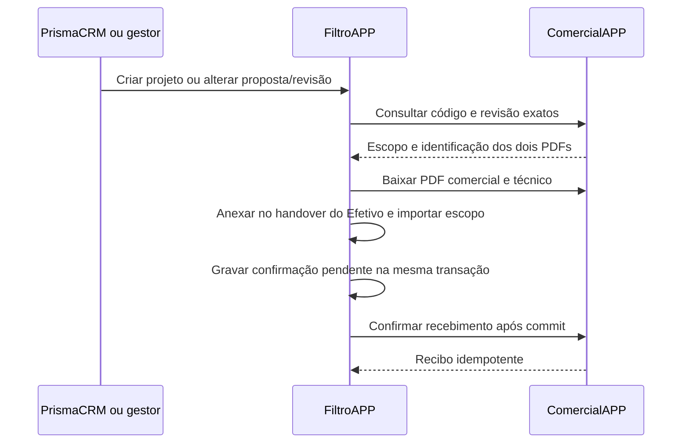

# Integração entre FiltroAPP e ComercialAPP

## Segmento e jornada do cadastro do projeto

O Prisma envia o segmento da empresa como `clientSegment` no cadastro de projetos
e como `opportunity.client.segment` no planejamento. Ambos são opcionais para
compatibilidade. O receptor reutiliza o catálogo por nome/slug, sem diferenciar
acentos, caixa ou a ordem das palavras; segmentos novos são cadastrados. Um item
inativo não é reativado pela integração. Campo ausente ou vazio preserva o projeto.

No ComercialAPP, **Mão de obra → Jornada para o cadastro do projeto** registra
`projectWorkSchedule: { workdayHours, weekendWorkdayHours }` em horas decimais,
independentes do cálculo financeiro. O primeiro campo vale de segunda a quinta
e o segundo na sexta e nos fins de semana incluídos. Os padrões são 9 e 8 horas.
Esses valores são exportados em `costBreakdown` da revisão finalizada e têm
prioridade sobre as horas de cálculo da fase. Um objeto presente e inválido
não é substituído silenciosamente pelas horas de cálculo.

**Fase de referência do projeto** seleciona a fase, salva em
`projectWorkScheduleContextId`. Seus toggles `includeSaturday` e `includeSunday`
definem os dias incluídos; na ausência deles, são usados `saturdayCount` e
`sundayCount`. Sem `projectWorkSchedule`, revisões anteriores continuam usando
`hoursPerDay` e as horas de fim de semana da fase. Horas decimais são convertidas
para duração: 8,8 h = 08:48. Cenários de cargos e
colaboradores não alteram o padrão do projeto. Propostas antigas com uma única
fase ativa permitem inferi-la; com várias fases é necessária seleção explícita.
Sem mão de obra, fase inválida ou ausente não sobrescrevem o cadastro.

Para esta ampliação de jornada, publique primeiro este receptor e depois o
ComercialAPP. Não há migração adicional de banco nem reprocessamento histórico.

Somente a principal selecionada aplica a jornada; adicionais e revisões apenas
armazenadas não alteram esses campos. `Project.integrationDefaults` registra os
valores integrados e os ajustes manuais por campo. Novas revisões acompanham a
origem enquanto o gestor não alterar aquele campo. Projetos antigos revisados,
sem esses metadados, conservam suas jornadas. Não há reprocessamento histórico em
massa; os novos dados entram na próxima criação, entrega ou seleção aplicável.

Publicar primeiro o receptor FiltroAPP com a migração
`20261026150000_project_integration_defaults`; depois publicar o ComercialAPP e o
emissor Prisma com as migrações `20261026150000_filtroapp_client_segment` e
`20261026150100_filtroapp_planning_segment`. Não emitir segmento antes de atualizar
o receptor, pois o contrato anterior rejeita propriedades desconhecidas.

## Busca de documentos e escopo iniciada pelo FiltroAPP

Quando o PrismaCRM cria um projeto ou informa uma revisão superior da mesma
proposta, o FiltroAPP agenda uma busca persistida no ComercialAPP. O mesmo
acontece no cadastro manual do projeto, na alteração do vínculo da proposta e
na escolha manual de uma revisão do orçamento (Access ou ComercialAPP).
Salvar outros campos ou repetir um evento não refaz uma importação concluída
nem desfaz uma revisão escolhida manualmente.



Configure a origem HTTPS do ComercialAPP em `COMERCIALAPP_API_URL` no
ambiente do FiltroAPP, sem caminho `/api`. Reutilize o segredo já compartilhado:
`COMERCIALAPP_SERVICE_TOKEN` no FiltroAPP e `FILTROAPP_API_TOKEN` no ComercialAPP.
Essas rotas usam o token de serviço do ambiente; não exigem token de usuário
nem permissões da Central de API.

O ComercialAPP oferece:

- `GET /api/integrations/filtroapp/propostas/:code/revisoes/:revision`:
  contrato versão 1 com cadastro da proposta, preço de venda, custo previsto,
  margem, resumo calculado de horas/custos, escopo, levantamento da finalização
  e metadados dos PDFs.
- `GET /api/integrations/filtroapp/propostas/:code/revisoes/:revision/documentos/:documentId`:
  download autenticado do PDF daquela proposta/revisão.

A proposta precisa estar finalizada e ter os PDFs comercial e técnico da mesma
geração, correspondentes ao conteúdo atual. A consulta independe da aprovação
no CRM. O FiltroAPP verifica código, revisão, CNPJ, vínculo do projeto quando
informado, tamanho e SHA-256 dos arquivos. Não busca uma revisão diferente
quando a solicitada estiver ausente. Cada PDF aceita até 10 MB, também sujeito
ao limite de documentos configurado no FiltroAPP.

Os arquivos ficam no armazenamento local do FiltroAPP, com versões imutáveis
e acesso pelas permissões existentes do projeto. Aparecem em **Efetivo →
Handover Comercial**, nos campos de proposta comercial e técnica, com código
e revisão visíveis. Uma revisão nova mantém os PDFs anteriores no histórico;
voltar a uma revisão já importada reutiliza suas versões. Os anexos da
integração são somente leitura.

A busca cadastra a proposta/revisão e preenche o orçamento vazio com origem
`COMERCIAL_APP`. Revisões superiores da mesma proposta atualizam somente uma
seleção automática; escolhas manuais e orçamentos Access são preservados. O
cadastro permite usar preço, custos e horas no Acompanhamento sem proposta na
base legada nem envio separado por webhook. O resumo mantém o levantamento da
finalização, mesmo que ele seja editado depois. A busca não confirma aceite
comercial nem movimenta etapas: `approvedAt` permanece nulo enquanto não houver
aprovação registrada no CRM. Um evento posterior complementa a mesma proposta
sem duplicar o orçamento.

O escopo usa a mesma projeção estruturada descrita abaixo. Edições manuais são
preservadas; serviços sem unidades ou quantidades seguras ficam como pendências
na origem do escopo. Sem levantamento estruturado, os PDFs continuam disponíveis
e o escopo exige conferência manual.

O worker consulta a fila a cada minuto, em lotes de dois projetos, com trava
compartilhada entre processos. Falhas e documentos ainda indisponíveis geram
retentativas persistidas de um minuto até uma hora. Uma alteração de revisão
substitui a solicitação anterior; respostas antigas são descartadas. Projetos
inativos, excluídos ou encerrados não são importados. A interface informa quando
os documentos da revisão ainda estão sendo aguardados.

Para implantar, publique primeiro as rotas do ComercialAPP; aplique a migração
`20261007190000_commercialapp_proposal_pull` no FiltroAPP e atualize API, worker
e frontend. Para a consulta completa, publique primeiro a ampliação do contrato
no ComercialAPP e aplique também a migração
`20261013190000_commercialapp_complete_proposal`. Ela permite proposta sem data
de aprovação e reagenda apenas buscas antigas já concluídas de projetos ativos
e não encerrados. O worker completa o cadastro e reutiliza os PDFs existentes;
escopo e escolhas manuais permanecem protegidos. Respostas da API antiga sem os
campos comerciais exigidos geram retentativa, sem concluir uma importação parcial.
Pare o worker antigo antes dessa migração e reinicie-o com a versão nova, para
que as buscas reagendadas sejam processadas pelo consumidor completo.
A fila permanece desabilitada enquanto a origem ou o token estiverem
vazios. Projetos anteriores não são importados em massa: o reenvio idêntico do
Prisma ou uma seleção/edição do vínculo inicializa a busca quando ela não existe.

O teste `backend/test/commercial-proposal-pull.integration.test.js` usa os dois
apps e bancos PostgreSQL isolados. Exige `DATABASE_URL=TEST_DATABASE_URL` com
banco `filtroapp_bridge_test`, `COMMERCIALAPP_TEST_DATABASE_URL` com banco
`comercialapp_test` e `COMMERCIALAPP_SOURCE_DIR` apontando para o checkout do
ComercialAPP. Valida revisão nova e manual, histórico, idempotência, retentativa,
resposta superada e rollback de banco/arquivos.

### Confirmação da importação no ComercialAPP

O worker envia `POST /api/integrations/filtroapp/propostas/:code/revisoes/:revision/recebimento`
com o mesmo Bearer da consulta. A migração `20261023210000_commercialapp_pull_receipts`
cria `CommercialAppReceipt`. O evento, com UUID, geração e hashes dos documentos,
é gravado na mesma transação dos PDFs, orçamento e escopo; só é enviado após o
commit. Consultas sem gravação, importações desfeitas e respostas superadas não
geram confirmação. A locação confirma seu PDF comercial; venda permanece excluída.

O ComercialAPP registra `SUCESSO` para `SELECTED` ou `AGUARDANDO_SELECAO` para
`STAGED`, preservando separadamente o estado do escopo e a aprovação no CRM.
Selecionar uma revisão antes recebida em staging agenda uma nova consulta e
confirmação, reutilizando as versões de documentos existentes. Edições manuais
do escopo continuam protegidas.

A fila de confirmações funciona independentemente das tentativas de importação.
Uma falha de rede ou perda do recibo repete exatamente o evento persistido,
sem reimportar dados. Claims vencem em um minuto; o processamento serializa os
eventos de cada proposta. A resposta precisa confirmar projeto, proposta,
revisão, geração e estados corretos. Falhas transitórias usam espera de um
minuto até uma hora; conflitos de contrato/autenticação ou dez falhas deixam
o evento em `REVIEW`, com código de erro e sem guardar o corpo externo.

Implante primeiro o receptor no ComercialAPP (migração
`20261023200000_filtro_pull_receipts`). Depois aplique a migração do FiltroAPP
e atualize API e worker. A migração não reimporta nem confirma propostas antigas.
O envio direto pelo ComercialAPP não precisa ser habilitado.

Para reconciliar uma importação anterior, informe os projetos explicitamente:

```bash
node scripts/backfill-commercialapp-receipts.js --project-id=ID
node scripts/backfill-commercialapp-receipts.js --project-id=ID --apply
```

Sem `--apply`, apenas verifica. A conferência consulta a revisão exata e valida
os hashes e bytes dos PDFs já armazenados no FiltroAPP. Com `--apply`, apenas
grava o evento para envio pelo worker; mantém orçamento, escopo e documentos.
Recibos existentes não são duplicados. Projetos inativos/encerrados e buscas
incompletas são ignorados; revisões indisponíveis e arquivos divergentes geram
erro para análise, sem reimportação. Use essa reconciliação dirigida depois do
deploy; o reprocessamento de envios ao PrismaCRM é uma operação separada.

`commercialapp-receipts.integration.test.js` usa PostgreSQL e HTTP e é executado
no CI de contribuições. Para executá-lo localmente, configure
`COMMERCIAL_RECEIPT_TEST_DATABASE_URL=DATABASE_URL` com banco local de teste.

## Receptor de propostas aprovadas no Acompanhamento

Esta branch adiciona uma entrada de serviço isolada do importador Access.
Configure `COMERCIALAPP_SERVICE_TOKEN` no `backend/.env` do FiltroAPP e use o
mesmo valor como `FILTROAPP_API_TOKEN` no ComercialAPP. Implante a migração
`20260929233000_comercialapp_bridge` antes de habilitar a entrega.

`POST /api/acompanhamento/comercial/comercialapp/propostas` exige Bearer token e
o contrato JSON versão 1 documentado em `comercialAPP/docs/INTEGRACOES.md`.
O receptor valida o projeto, grava proposta/revisão e evento de entrega com
identificadores únicos. Repetir um evento idêntico não duplica o orçamento.
`GET /api/acompanhamento/comercial/comercialapp/projetos?busca=...` usa o mesmo
token e permite ao gestor do Comercial localizar projetos ativos para o fallback
manual.

Uma primeira revisão aprovada preenche um orçamento vazio e aparece no
dashboard. Revisões posteriores ficam em staging; consulte por
`GET /api/acompanhamento/comercial/projetos/:projectId/comercialapp/revisoes`
e selecione com `POST .../comercialapp/selecionar`, corpo
`{"externalId":"id-da-proposta-no-comercialapp"}`. Esses dois endpoints usam a
autenticação normal do FiltroAPP; a seleção exige gestor do Acompanhamento.
Quando já existe orçamento de origem Access, a revisão nova fica em staging e
a seleção automática não o substitui. O gestor pode escolher a revisão na tela
do projeto; a interface pede confirmação da troca de origem antes de atualizar
o orçamento.

## Origem dos dados do projeto e da proposta

O Prisma CRM cria no FiltroAPP o projeto e seu vínculo comercial: código e nome
do projeto, cliente/CNPJ, código e revisão da proposta e local. Essa chamada
não envia horas ou custos. Depois da aprovação, o ComercialAPP envia a proposta
diretamente ao endpoint acima, usando o ID do projeto informado pelo CRM.

O envio do ComercialAPP inclui preço de venda, custo total e margem do
levantamento vinculado, os itens estruturados do escopo da proposta e o payload
integral desse levantamento. Inclui
também `estimateSummary` quando há levantamento: horas normais, extras e totais;
fases e carga de trabalho; custos calculados por categoria, incluindo bônus de
indicação. O custo previsto é o custo direto. Filtros e efluente já estão
incluídos nos insumos; tributos, comissões, despesas comerciais e overhead são
valores de precificação separados. Sem levantamento,
`estimateSummary` é `null` e o custo total não é informado. A versão 1 anterior
do contrato, sem esse campo, continua aceita.

O FiltroAPP usa as horas somente da revisão do ComercialAPP selecionada no
orçamento. Uma revisão em staging não altera a previsão. Horas manuais
divergentes continuam exigindo conferência no cronograma. O dashboard expõe as
categorias do levantamento separadas dos componentes históricos do Access;
campos sem equivalência segura, como dias trabalhados por projeto, não são
inferidos de fases que podem ocorrer em paralelo.

## Escopo previsto no cronograma

Ao selecionar uma revisão do ComercialAPP, o FiltroAPP lê os circuitos,
itens dimensionados e vínculos de serviço do `costBreakdown` e cadastra o
escopo previsto se o projeto ainda não tem serviços manuais. Uma nova revisão
atualiza somente o escopo que a integração havia criado; qualquer edição
manual, inclusive a exclusão de todas as linhas, preserva a decisão humana.
Uma alteração somente das horas não altera a origem do escopo.
Reenvios da proposta só sincronizam quando ela continua sendo a revisão vigente
do orçamento no FiltroAPP.
O gestor pode acionar **Sincronizar escopo** na revisão atual para importar
propostas recebidas antes desta funcionalidade.

Tubulações usam quantidade × comprimento em metros. A bitola informada em
polegadas no ComercialAPP é gravada em milímetros para o cálculo de volume e
volta a polegadas no cronograma (por exemplo, 50,8 mm → 2 pol). Volumes de
óleo usam litros, sem multiplicar pelos ciclos do circuito. Limpeza química,
teste hidrostático, flushing e filtragem entram nas categorias acompanhadas
pelo RDO; serviços sem categoria ou unidade segura aparecem como pendências
para conferência no editor do cronograma. Flushing primário e secundário no
mesmo item compõem uma única medição de flushing. Os pesos iniciais das
categorias são distribuídos igualmente e podem ser editados pelo gestor.

Itens com `measurementUnit` usam o quantitativo contratado nessa unidade antes
de qualquer dedução pelo tipo do item. `quantity` é a contagem de itens e as
medidas são por item:

| Unidade comercial | Quantidade prevista | Medição de limpeza mecânica |
| --- | --- | --- |
| `m` | `quantity * lengthM` | `MECANICA_M/M` |
| `kg` | `quantity * weightKg` | `MECANICA_KG/KG` |
| `un` | `quantity` | `MECANICA_UN/UN` |
| `L` | `quantity * volumeLiters` | `MECANICA_L/L` |

Para os demais serviços, tubulações em metros com bitola usam `TUBULACAO/M`;
limpeza química por unidades usa `SISTEMA/UN` e teste de pressão por unidades
usa `MANGOTE/UN`, sem exigir bitola. Reservatórios e equipamentos em litros
usam `OLEO/L` em filtragem ou flushing. Óleo mantém `OLEO/L` nesses serviços.
Combinações sem medição nativa geram pendência para revisão, sem converter a
unidade escolhida. Ciclos e `calculateVolume` não alteram o quantitativo
contratado; medidas físicas preservadas para cálculo de volume não substituem
esse quantitativo quando o cálculo está desativado. Itens antigos sem
`measurementUnit` mantêm as regras anteriores.

Publique este receptor antes do emissor do ComercialAPP. Entregas antigas sem
`estimateSummary` continuam válidas; propostas já concluídas no ComercialAPP
precisam de uma rotina específica de atualização para receber o novo campo.
